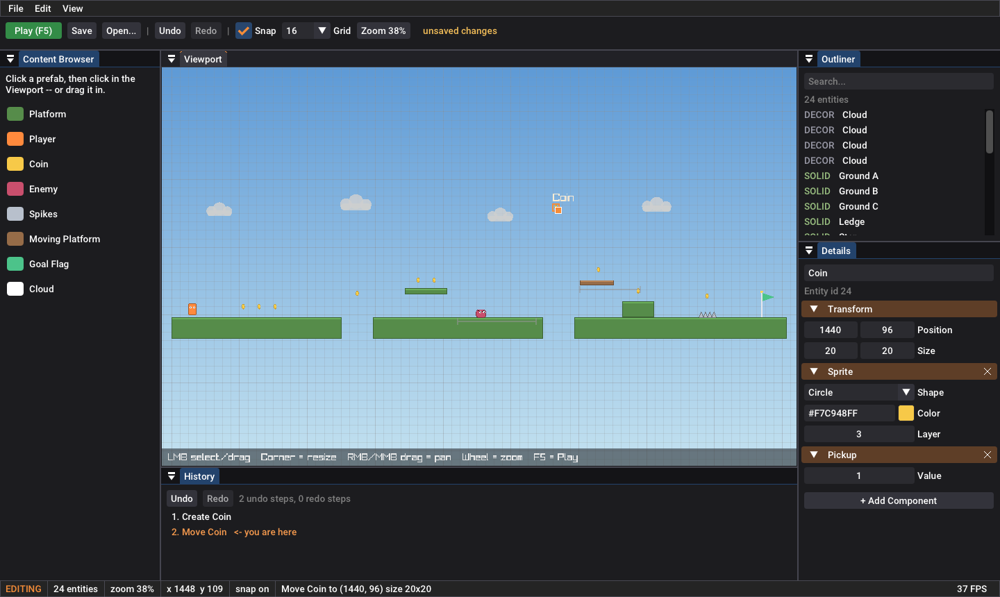
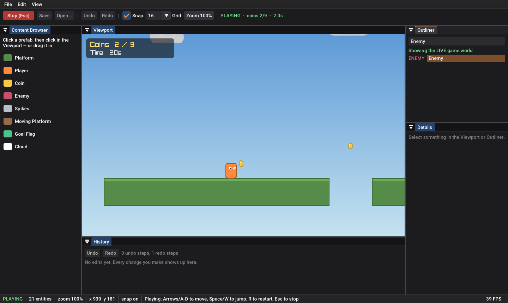

# Ember — a tiny 2D game engine with an Unreal-style level editor

Build levels in a docked editor (Viewport, Outliner, Details, Content
Browser, History), press **Play** to test them instantly, press **Stop** and
the level snaps back exactly as it was. Every edit is undoable. Levels save
as readable JSON.





## Build and run (macOS)

```bash
xcode-select --install     # Apple's compiler
brew install cmake

cmake -S . -B build        # first time: downloads raylib, Dear ImGui, nlohmann/json (~1-2 min)
cmake --build build -j

./build/ember_tests        # 26 engine tests, no window needed
./build/ember              # the editor (opens levels/demo.json)
```

Run it from the project folder so it finds `levels/demo.json`. The panel
layout is remembered in `ember_layout.ini`; delete that file (or View → Reset
layout) to get the default back.

## Controls

**Editor**

| Do this | How |
|---|---|
| Select | Left-click in the Viewport, or click in the Outliner |
| Move / resize | Drag the object / drag its orange corner handle (snaps to grid; **G** toggles snap) |
| Place something | Click a prefab in the Content Browser, then click in the Viewport — or drag it in. Hold **Shift** to keep placing |
| Pan / zoom | Right- or middle-drag (or **Space** + left-drag) / mouse wheel. **Home** frames the whole level, **F** frames the selection |
| Nudge | Arrow keys (Viewport focused) |
| Undo / redo | **Cmd+Z** / **Cmd+Shift+Z** or **Cmd+Y** (Ctrl on Linux/Windows) |
| Duplicate / delete | **Cmd+D** / **Delete** |
| Edit properties | Details panel. **+ Add Component** / the **×** on a component header |
| Save | **Cmd+S** (File → Save As / Open for other files) |
| Play / Stop | **F5** or the green button / **Esc** |
| Screenshot | **F12** (raylib built-in; saves `screenshotNNN.png`) |

**Game:** Arrows or A/D to move, Space / W / Up to jump, **R** to restart, **Esc** back to the editor.

## How it's built

```
┌──────────────────────────── engine/  (pure C++, NO graphics) ───────────────────────────┐
│  math.hpp      Vec2, Rect (AABB)                                                         │
│  entity.hpp    Entity = Transform + optional components (Sprite, Collider, Body, ...)    │
│  world.*       the list of entities -- a plain value: `World copy = world;` works        │
│  systems.*     the game: input -> patrol -> physics -> triggers, at a fixed 60 Hz        │
│  commands.*    undo/redo (Command pattern)                                               │
│  level_io.*    save/load JSON, with a format version                                     │
│  prefabs.*     ready-made entities + the demo level                                      │
└──────────────────────────────────────────────────────────────────────────────────────────┘
                  ▲ used by                                    ▲ used by
┌─────────── editor/  (raylib + Dear ImGui) ───────────┐   ┌──── tests/ ────┐
│  editor_app.*  frame loop, Play-In-Editor, shortcuts │   │  26 tests,     │
│  panels.cpp    Toolbar, Outliner, Details, ...       │   │  headless      │
│  viewport.cpp  picking, dragging, placing, camera    │   └────────────────┘
│  renderer.*    entity data -> shapes on screen       │
└──────────────────────────────────────────────────────┘
```

The single most important design decision: **the engine knows nothing about
graphics or UI.** That's why it can be tested without a window, why a bot
can play the game in a unit test, and why you could swap raylib for
something else without touching gameplay code.

### Read it in this order

Each file is short and commented. Read them in order and each one only uses
ideas from the files before it.

| # | File | What you'll understand after reading it |
|---|---|---|
| 1 | `engine/include/ember/math.hpp` | Screen-style coordinates (y down), axis-aligned bounding boxes, the overlap test every collision uses |
| 2 | `engine/include/ember/entity.hpp` | **Components:** behaviour comes from combining data, not from class hierarchies |
| 3 | `engine/include/ember/world.hpp`, `src/world.cpp` | Owning entities by value; why ids instead of pointers |
| 4 | `engine/include/ember/systems.hpp`, `src/systems.cpp` | The game loop: **fixed timestep**, coyote time, move-x-then-y collision, moving platforms, never erasing from a vector while iterating it |
| 5 | `engine/src/prefabs.cpp` | Prefabs (≈ Blueprints) and how the demo level is built |
| 6 | `engine/include/ember/commands.hpp`, `src/commands.cpp` | **Undo/redo**: why every edit is an object with apply() + revert() |
| 7 | `engine/src/level_io.cpp` | Serialization, defaults for missing fields, format versioning |
| 8 | `editor/src/renderer.cpp` | Turning data into pixels; painter's algorithm (layers) |
| 9 | `editor/src/viewport.cpp` | Render-to-texture, screen↔world camera math, picking, dragging with one undo step per drag |
| 10 | `editor/src/panels.cpp` | Immediate-mode UI; the **"track_edit" pattern** that makes slider drags undoable |
| 11 | `editor/src/editor_app.cpp` | The frame loop, docking layout, **Play-In-Editor**, shortcuts |
| 12 | `tests/*.cpp` | How each of the above is proven to work |

### How it maps to Unreal Engine

| Unreal | Ember | Where |
|---|---|---|
| Actor | `Entity` | `entity.hpp` |
| Actor Components | `Transform`, `Sprite`, `Body`, `Patrol`, ... | `entity.hpp` |
| Blueprint class | `Prefab` | `prefabs.cpp` |
| World / Level | `World` | `world.hpp` |
| Tick | `step()` + systems | `systems.cpp` |
| Play In Editor (PIE) | copy the World on Play, restore on Stop | `editor_app.cpp` → `play()` / `stop()` |
| Transactions (undo) | `Command` + `History` | `commands.hpp` |
| World Outliner / Details / Content Browser | the same panels | `panels.cpp` |
| Level Viewport | render texture inside an ImGui window | `viewport.cpp` |
| .umap asset | `.json` level file | `level_io.cpp` |

## How it was verified

- **26 engine tests**, e.g.: the player lands exactly on a platform; walls stop it;
  jump height matches the physics formula (99.9 vs. ideal 104.5 — the gap is the
  discrete timestep); coyote time accepts a jump 0.05 s after leaving a ledge but
  refuses one at 0.20 s; moving platforms carry the player; coins, hazards, goal and
  falling all do the right thing.
- **Undo/redo fuzzing:** 200 random creates/deletes/edits, then undo *all* → the level
  is identical to the original; redo all → identical to the final state.
- **A bot beats the demo level** in a test (holds right, jumps at pits, walls and
  hazards; wins in 9.3 s). If you change physics or the level so it can't be won, this fails.
- **Play-In-Editor:** after playing, the edited level is bit-for-bit unchanged.
- **Real UI session:** the editor was driven with simulated mouse and keyboard input
  (place a coin, drag it, undo twice, search the Outliner, delete the Enemy, undo,
  Play, Stop, Save); the saved file was then confirmed identical to the original level.
- **Sanitizers:** engine tests and that same UI session are clean under AddressSanitizer
  + UndefinedBehaviorSanitizer.
- Builds warning-free with GCC 13 and Clang 18 + libc++ (the Mac's standard library).
  Engine code uses `-Wall -Wextra -Wpedantic -Wshadow -Wconversion -Werror`.

```bash
# Sanitizer build of the engine tests:
cmake -S . -B build-asan -DEMBER_BUILD_EDITOR=OFF -DCMAKE_BUILD_TYPE=Debug -DSANITIZE="address,undefined"
cmake --build build-asan -j && ./build-asan/ember_tests
```

## Known limitations

- One selected entity at a time (see exercise 4).
- Only axis-aligned boxes collide; no slopes or rotation.
- Shapes, not textures (see exercise 6).
- On Retina screens the UI may look slightly soft — raylib runs without its high-DPI flag here
  to keep mouse coordinates simple. Turning `FLAG_WINDOW_HIGHDPI` on is a good small exercise.
